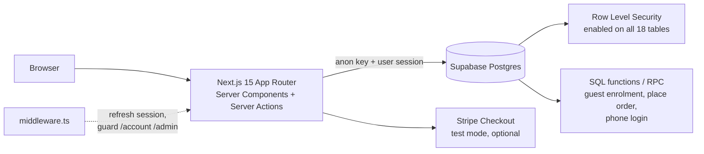

# educasketball-demo

A class-enrolment and membership system for a fictional basketball training school: public booking site, member area, shop, and an admin back office. Built to show a full Next.js + Supabase stack where the database does the access control.

All data is fictional. The UI is in Hong Kong Cantonese because the product is aimed at small Hong Kong businesses; this README and the code structure are in English.

## What's in it

- **Public site**: courses, class timetable, coaches, shop, guest enrolment (a full class becomes a waitlist entry), custom-order requests.
- **Member area**: students under one account, enrolments, attendance, points, orders, calendar feed (`.ics`).
- **Admin back office**: enrolment board and list, attendance, classes and venues, products and stock, orders, members, notes, settings. Coach accounts see a restricted view.
- **Payments**: a built-in demo payment flow, or Stripe Checkout in test mode when keys are set.

## Architecture



The browser never talks to the database with elevated rights. Server code uses the signed-in user's session, and Postgres decides what that user may read or write. The middleware refreshes the session and redirects, but each admin page and action re-checks the role.

## Stack

Next.js 15 (App Router), React 19, TypeScript, Tailwind CSS 3, Supabase (Auth, Postgres, Storage), optional Stripe, deployable on Vercel.

## Run it locally

Requirements: Node 20+, Docker Desktop (for the local Supabase stack).

```bash
npm install
npx supabase start            # first run downloads images
npx supabase db reset         # applies all migrations and seed.sql
cp .env.example .env.local    # fill NEXT_PUBLIC_SUPABASE_ANON_KEY from `supabase start` output
npm run dev                   # http://localhost:3000
```

Test accounts created by `supabase/seed.sql` (local database only):

| Role | Email | Password |
|---|---|---|
| Admin | admin@educasketball.test | `Demo1234!` |
| Coach | coach@educasketball.test | `Demo1234!` |
| Member | member@educasketball.test | `Demo1234!` |

```bash
npx supabase test db          # SQL tests (pgTAP)
npm run typecheck
```

## Database

29 migrations in `supabase/migrations/`, applied in order. The ones worth reading:

- `…_rls.sql`: row level security on all 18 tables; members only see their own students, enrolments, orders and points.
- `…_enroll_guest_rpc.sql`: guest enrolment as one database function: it checks the class, creates the student and writes the enrolment in a single call, and a trigger turns an over-capacity enrolment into a waitlist entry.
- `…_function_grants.sql`: which roles may call which functions.
- `…_phone_login_key.sql`: closes a data leak in an earlier version of the phone login (see below).

### SQL tests

`supabase/tests/` has five pgTAP files (110 planned assertions). `member_isolation.test.sql` creates two members with students, enrolments, attendance, points, orders and custom requests, then checks that member A can neither read nor modify any of member B's rows. The tests run inside a transaction and roll back.

## Things I learned building it

**A helper that looked up an email by phone number was a data leak.** An earlier version of phone login used a function that returned a member's email for a given phone number, callable by anonymous users. That makes it a way to harvest emails. Migration 25 requires a server-side secret (`PHONE_LOGIN_KEY`, stored in a `private` schema that anon and authenticated roles cannot read), and phone login stays disabled until the secret exists. The secret is not in the repository.

**Test the policies, not only the pages.** Clicking through as a member does not prove another member's data is unreachable. The isolation test exercises the same queries an attacker would and fails if a policy is missing or too wide.

**`basePath` leaks into places the framework does not fix.** Plain `<a href>` links, form actions, `fetch` calls, and redirects inside Server Actions do not get the sub-path added automatically. The app reads `NEXT_PUBLIC_BASE_PATH` where needed, and admin form actions redirect from the client side for that reason.

**Make the public demo safe by default.** With `NEXT_PUBLIC_DEMO_LOCK=1`, actions that could be abused (changing settings or roles, uploading files) return a message instead of running. Demo data can be reset with the `demo_reset` migrations.

## Limits

- No automated browser tests; verification is the SQL tests plus manual use.
- Stripe is test-mode only and the webhook path is lightly tested.
- The UI is Cantonese only; there is no i18n layer.

## Layout

```
app/            routes: (public), (account), (admin), api/
components/     UI and feature components
lib/            data access, payment, phone and date helpers
supabase/       migrations, seed.sql, pgTAP tests, config.toml
```

## Licence

MIT
